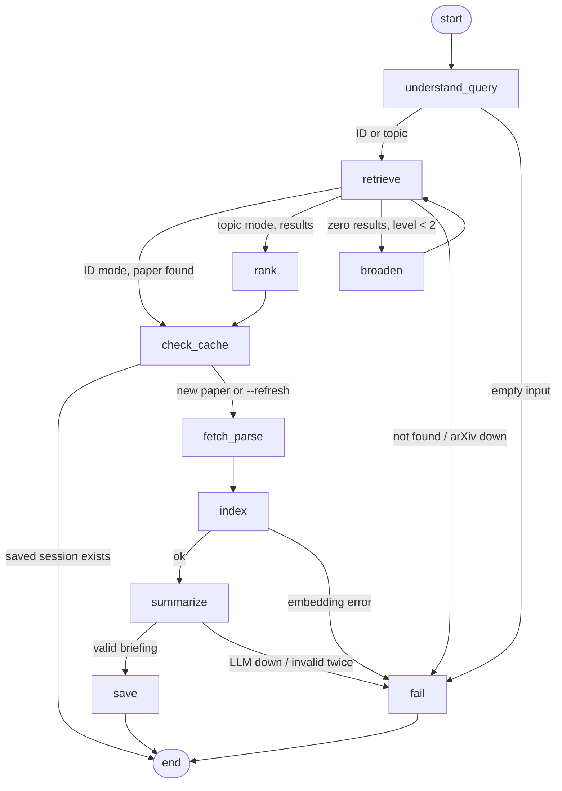
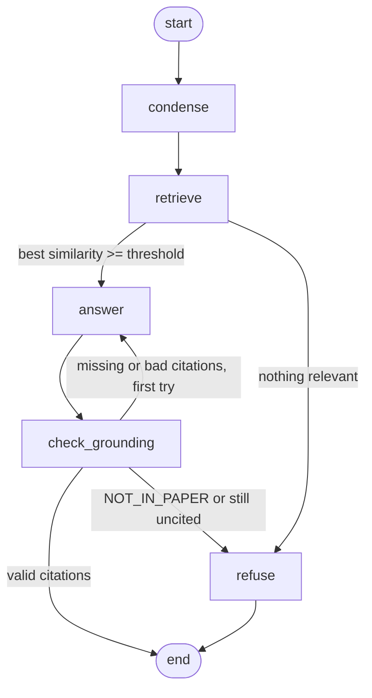

# arXiv Digest & QA Agent

Give it a research topic or an arXiv ID. It finds the paper, reads the PDF, writes a one-page briefing, and then answers your questions about the paper with citations to the exact passages it used. If the paper doesn't say something, it tells you so instead of making it up.

```
python -m arxiv_agent brief "recent work on KV-cache compression for LLMs"
python -m arxiv_agent brief 2401.12345
python -m arxiv_agent brief https://arxiv.org/abs/2401.12345
```

Everything runs locally except the LLM call, which goes to Groq's free tier by default. You can point it at a local Ollama model instead and run fully offline after the first setup.

## Contents

1. [Setup](#setup)
2. [Usage](#usage)
3. [Example run](#example-run)
4. [Architecture](#architecture)
5. [Design decisions and tradeoffs](#design-decisions-and-tradeoffs)
6. [Known limitations and next steps](#known-limitations-and-next-steps)
7. [Rate limits](#rate-limits)
8. [Project layout](#project-layout)

## Setup

Needs Python 3.10 or newer and about 1 GB of disk for PyTorch and the embedding model.

```bash
git clone <this repository's URL> arxiv-digest-agent
cd arxiv-digest-agent
python -m venv .venv
```

Activate the environment:

```bash
# Windows PowerShell
.venv\Scripts\Activate.ps1
# macOS / Linux
source .venv/bin/activate
```

Install dependencies. On Linux, install the CPU build of PyTorch first so pip doesn't pull the 2 GB CUDA build:

```bash
pip install torch --index-url https://download.pytorch.org/whl/cpu   # Linux only, optional
pip install -r requirements.txt
```

Add your LLM key:

```bash
cp .env.example .env          # Windows: copy .env.example .env
```

Open `.env` and paste a free Groq key from https://console.groq.com/keys into `GROQ_API_KEY`. No card needed.

The first run downloads `all-MiniLM-L6-v2` (about 90 MB) from Hugging Face. After that it is cached.

### Running with Ollama instead of Groq

```bash
ollama pull qwen2.5:7b-instruct
```

Then in `.env`:

```
LLM_PROVIDER=ollama
LLM_MODEL=qwen2.5:7b-instruct
```

A 7B model gives noticeably weaker briefings than GPT-OSS 120B, but no key and no rate limits.

### Tests

```bash
python -m pytest
```

53 tests. They use a fake LLM, a fake or mocked arXiv client and a hash-based embedder, so they run offline in a couple of seconds. One of them parses a real two-column LaTeX PDF checked into `tests/fixtures/`.

## Usage

| Command | What it does |
|---|---|
| `python -m arxiv_agent brief "<topic or ID>"` | Runs the full pipeline, prints the briefing, opens the Q&A prompt |
| `python -m arxiv_agent brief <ID> --no-qa` | Briefing only |
| `python -m arxiv_agent brief <ID> --refresh` | Ignores the saved session and rebuilds everything |
| `python -m arxiv_agent ask <ID>` | Reopens Q&A on a paper you already briefed, with its chat history |
| `python -m arxiv_agent ask <ID> -q "question"` | One question, one answer |
| `python -m arxiv_agent list` | Papers with saved sessions |
| `python -m arxiv_agent export <ID>` | Writes briefing + Q&A transcript to `examples/<ID>.md` |
| `python -m arxiv_agent graph` | Prints both state graphs as Mermaid, generated from the compiled graphs |

Each briefing is saved to `outputs/<arxiv_id>/briefing.md` and `briefing.json`.

## Example run

Input, a topic rather than an ID:

```
python -m arxiv_agent brief "KV cache compression for long context LLMs"
```

Full output, with the briefing and three Q&A exchanges (one of them a question the paper can't answer): **[examples/2511.01815.md](examples/2511.01815.md)**

This run also shows the fallback path. The arXiv API refused the search with HTTP 406, so the agent took candidate metadata from OpenAlex, ranked five papers, and still downloaded and parsed the PDF from arXiv. Shortened terminal output:

```
  -> understand_query
  -> retrieve
     ! The arXiv API refused the request, so paper metadata came from OpenAlex. arXiv categories are missing.
  -> rank
  -> check_cache
  -> fetch_parse
  -> index
  -> summarize
  -> save

# KV Cache Transform Coding for Compact Storage in LLM Inference
...
## Limitations
- Frobenius-norm reconstruction error is used as a proxy for downstream task performance, which may not reliably predict accuracy across all tasks (stated by the authors)
- Calibration requires processing ~200K tokens on a single GPU, which could be costly for very large models or frequent re-calibration (inferred, not stated by the authors)
...
## How this briefing was built
- Pages read: 48 of 48
- Sections found: 14, references found: 197
- Chunks indexed for QA: 168

you> What compression ratio does KVTC achieve?
agent> ... In the main experiments it attains very high ratios of 32x and 64x while still preserving
accuracy, and it even maintains comparable performance at about 20x compression [2][4]. ...
   [2] 4 EXPERIMENTS > 4.1 RESULTS (p. 8)
   [4] B ABLATIONS AND ADDITIONAL DETAILS (p. 44)

you> How long does its calibration take?
agent> KVTC's calibration step is fast; for example, calibrating a 12 B model can be completed in
under 10 minutes on an H100 GPU [3].
   [3] 3 METHOD (p. 5)

you> Does it work on image generation models?
agent> The paper doesn't cover this, as far as the retrieved passages show. Closest sections:
3 METHOD, 1 INTRODUCTION, Abstract.
```

The second question only says "its". The `condense` node rewrote it into a standalone question about KVTC before retrieval.

## Architecture

There are two LangGraph state graphs. The ingest graph runs once per paper. The QA graph runs once per question. They share state through a session file and a Chroma collection on disk, so you can close the terminal, come back tomorrow, and keep asking questions without re-downloading or re-embedding anything.

### Ingest graph



| Node | Job |
|---|---|
| `understand_query` | Regex for new-style (`2401.12345v2`) and old-style (`hep-th/9901001`) IDs, including inside URLs. Otherwise asks the LLM for 2 to 4 search phrases, arXiv categories and whether the user wants recent work. If that call fails, falls back to plain keyword extraction. |
| `retrieve` | Calls the official arXiv Atom API. Waits 3 seconds between calls as arXiv asks. Sends an explicit `Accept: application/atom+xml` header, retries on 406, 429 and 5xx, and falls back from `export.arxiv.org` to `arxiv.org/api/query` when the export host keeps refusing. If both refuse, it gets the same metadata from Semantic Scholar, then OpenAlex, and the briefing says which source was used. |
| `broaden` | Loosens the query when a topic search returns nothing. Level 0 is `abs:` phrases AND-ed with categories, level 1 drops categories and searches all fields, level 2 OR-s the individual words. |
| `rank` | Embeds the topic and each candidate's title + abstract, sorts by cosine similarity, adds a small recency bonus when the user asked for recent work. Keeps the top paper and records the next four as alternatives. Warns when the best score is low. |
| `check_cache` | If this paper already has a saved briefing and a matching vector index, skips the expensive steps. |
| `fetch_parse` | Downloads the PDF and splits it into sections (details below). Falls back to the arXiv abstract if the download fails or the PDF has no real text layer. |
| `index` | Section-aware chunking, embeddings, Chroma collection per paper. |
| `summarize` | Builds a token-budgeted context, retrieves limitation passages separately, asks for a JSON briefing, validates it with Pydantic, retries once with the validation error. |
| `save` | Writes `briefing.md`, `briefing.json` and the session file. |
| `fail` | Turns whatever went wrong into one readable message. |

### QA graph



| Node | Job |
|---|---|
| `condense` | Rewrites a follow-up like "how much latency does it add?" into a standalone question using the last three turns. Skipped on the first question. |
| `retrieve` | Hybrid search: BM25 and dense vectors, merged with reciprocal rank fusion. |
| `answer` | Numbered excerpts go to the LLM with rules: cite every claim, answer `NOT_IN_PAPER` if the excerpts don't contain it. |
| `check_grounding` | Parses the citations. Rejects the answer if it has none, cites an excerpt number that doesn't exist, or leaves more than two-thirds its sentences uncited. |
| `refuse` | Says the paper doesn't cover it and names the closest sections it found. |

### State

Ingest state (`IngestState` in `graph.py`):

| Field | Set by | Used by |
|---|---|---|
| `user_input`, `refresh` | CLI | `understand_query`, `check_cache` |
| `mode`, `arxiv_id`, `topic`, `plan` | `understand_query` | everything after |
| `search_level`, `search_query` | `retrieve`, `broaden` | routing, error message |
| `candidates`, `alternatives` | `retrieve`, `rank` | `rank`, `save` |
| `paper` | `retrieve` or `rank` | all later nodes |
| `sections`, `parse_report` | `fetch_parse` | `index`, `summarize`, `save` |
| `chunks` | `index` | `summarize`, `save` |
| `briefing`, `briefing_markdown`, `output_dir` | `summarize`, `save` | CLI |
| `warnings` | any node | appended with an `operator.add` reducer, shown in the briefing |
| `error` | any node | routes to `fail` |

QA state (`QAState` in `qa.py`): `arxiv_id`, `title`, `chunks`, `history`, `question`, `standalone`, `hits`, `best_similarity`, `attempts`, `answer`, `citations`, `status`.

Persisted between runs:

```
.data/pdfs/<id>.pdf          downloaded once
.data/chroma/                one collection per paper
.data/sessions/<id>.json     paper metadata, briefing, chunks, parse report, Q&A history
outputs/<id>/briefing.md     human-readable briefing
outputs/<id>/briefing.json   same thing, machine-readable
```

## Design decisions and tradeoffs

**Two graphs instead of one.** The pipeline is "build once, ask many times". Putting the QA loop inside the ingest graph would mean either re-running ingestion per question or keeping a process alive with a checkpointer. Splitting them keeps each graph small and lets a session survive a restart. The cost is that the two graphs agree on a file format rather than a shared Python object.

**Parsing with PyMuPDF and font heuristics.** I read every text block with its font size and bold flag. The most common font size by character count is the body size. A short line counts as a heading if it is numbered (`3`, `3.1`, `IV.`) and set larger or bold, or if it is a known heading word like "Limitations" or "References". Subsections get their parent's title in front (`3 Method > 3.1 Routing Network`), which helps both retrieval and the summary budget. Lettered headings (`A Proofs`) only count after the references, so a bold line starting with "A New ..." in the body isn't mistaken for an appendix. Running headers and footers are dropped when the same short line appears on 40% of pages. The arXiv margin watermark is rotated text, so it is skipped by direction. I tested this on a real two-column pdflatex paper, which is how I found that LaTeX writes spaces as separate spans and that hyphenated line breaks need rejoining by hand.

GROBID or Nougat would parse layout far better, but GROBID needs a Java service and Nougat needs a GPU. For a tool that should run on a laptop in one `pip install`, heuristics that degrade gracefully felt like the right call.

**The abstract comes from arXiv, not the PDF.** The API abstract is clean text. PDF abstracts come out with odd line breaks and sometimes merge with the author block.

**Failure handling.** Five failures have a defined path:
- arXiv API refuses the request: in September 2026 the export API started answering HTTP 406 to many uncached queries. The client retries, tries the second arXiv host, then pulls metadata from Semantic Scholar or OpenAlex (both map results back to arXiv IDs, so the PDF still comes from arXiv). The briefing flags the fallback, since those sources don't carry arXiv categories.
- Topic returns zero papers: broaden twice, then stop with a message that suggests passing an ID.
- Topic returns many weak matches: rank by embedding similarity, warn if the best score is under 0.35, list the next four candidates so the user can rerun with a specific ID.
- PDF download fails or the PDF is scanned (under 300 characters per page): continue with the abstract only. The briefing says so in bold, and the summary prompt tells the model to keep claims modest.
- Huge paper: only the first 60 pages are read, and the briefing says how many were skipped.

**Chunking.** About 1,000 characters per chunk with a 150-character overlap cut on sentence boundaries. MiniLM truncates at 256 word pieces, which is roughly 1,000 characters of English, so longer chunks would lose their tail silently. Chunks never cross section boundaries, and the section title is prepended before embedding so "what datasets did they use" can match an Experiments chunk that never uses the word "dataset". References are indexed but filtered out of search unless the question mentions citations or prior work, because otherwise reference lists match almost any keyword.

**Hybrid retrieval.** Dense embeddings are good with paraphrase and bad with exact tokens like "LongBench", "H2O" or "41.3". BM25 is the opposite. Reciprocal rank fusion merges the two lists without tuning weights. I used RRF in an earlier RAG project and kept it here for the same reason.

**Summarizing inside a token budget.** Groq's free tier caps tokens per minute, so a map-reduce summary over every chunk would stall for minutes on a long paper. Instead I rank sections by how useful they are for a briefing (abstract, introduction, conclusion and limitations first, then method, then experiments), take up to a quarter of the budget from each, and put the excerpts back in document order. Separately, I run a retrieval query for limitation-type passages and give those to the model in their own block. Authors often bury limitations in the discussion or an appendix, and the brief explicitly says not to let the model skip them.

**Keeping the briefing honest.** The output is validated against a Pydantic schema. Limitations must be non-empty, and each is tagged `stated` (the authors say it) or `inferred` (the model's reading of the setup). An invalid response is sent back once with the exact validation error. After that, every number in "Key results" is checked against the text the model actually saw, and any number that doesn't appear there is listed in the briefing as something to verify. This catches the most common hallucination in paper summaries, which is a confident but wrong figure.

**Keeping QA grounded.** Three layers. (Citation parsing accepts the styles models actually produce, such as `[1, 2]`, `[2-4]` and GPT-OSS's `【1†L3-L5】`, and rewrites them to `[1]` form before checking. My first version only accepted `[1]` and wrongly refused correct answers.) First, if the best dense similarity is below 0.28 the agent refuses without calling the LLM, which is cheap and stops "who won the World Cup" from ever reaching the model. Second, the prompt forbids outside knowledge and defines `NOT_IN_PAPER` as the answer for missing information. Third, the answer is checked for real citations and sent back once if they're missing or point at excerpts that don't exist. If the retry fails too, the user gets a refusal rather than an unsupported answer, and the rejected drafts are kept in the session file so I can see why.

**LLM choice.** Groq with `openai/gpt-oss-120b` because it's free, fast and handles JSON output well. I started on Llama 3.3 70B, but Groq retired it on 16 August 2026, which is exactly why the model name lives in `.env` and not in code. GPT-OSS is a reasoning model, so the client asks for low reasoning effort and adds token headroom for the hidden reasoning, and retries once with a bigger budget if the answer comes back empty. The client is the OpenAI SDK pointed at an OpenAI-compatible endpoint, so Groq and Ollama are the same code path and switching is two lines in `.env`.

## Known limitations and next steps

- **One paper per topic.** A topic query briefs the best match and lists four alternatives. It doesn't compare papers. A multi-paper mode would need a map step per paper and a synthesis node.
- **No human pick.** The agent chooses the top-ranked paper itself. With more time I'd add a LangGraph `interrupt` after `rank` so the user can choose from the shortlist before anything is downloaded.
- **Heuristic parsing.** Papers whose headings are unnumbered and set in the body font come out as one long section. Tables and equations come through as flattened text, and figure content is lost. No OCR, so scanned papers only get the abstract.
- **Long papers lose middle detail in the briefing.** The QA side still sees every chunk, but the summary sees about 18,000 characters.
- **Thresholds are reasoned, not measured.** `MIN_SIMILARITY=0.28` and the 0.35 ranking warning come from how MiniLM cosine scores usually spread for related and unrelated text. They should be tuned on a labeled set.
- **The number check only checks numbers.** A wrong claim with no figures in it passes.
- **No evaluation set.** Next step would be around 30 questions across three papers, with expected source sections and some unanswerable questions, measuring retrieval Recall@k and how often the agent correctly refuses.
- **Follow-up rewriting costs an extra LLM call** on every question after the first.

## Rate limits

Groq's free tier limits requests and tokens per minute and per day, per model. The exact numbers for `openai/gpt-oss-120b` on your account are at https://console.groq.com/settings/limits. Groq also retires models regularly; if you get a "model not available" error, pick a current one from https://console.groq.com/docs/models and set `LLM_MODEL` in `.env`.

What this project uses:

| Step | Calls | Approx. tokens |
|---|---|---|
| Topic planning (topic mode only) | 1 | ~400 |
| Briefing | 1, sometimes 2 | ~6,000 to 7,500 |
| Each question | 1 to 3 (condense, answer, maybe a retry) | ~2,000 to 3,000 |

That's roughly a dozen fresh briefings a day, plus questions. Re-running a paper that's already saved costs nothing. On a 429 the client reads the `retry-after` header, waits and retries up to five times. If you hit the daily cap, set `LLM_MODEL=openai/gpt-oss-20b` (smaller and cheaper on the limits) or switch to Ollama.

arXiv asks for no more than one request every three seconds. The client enforces that.

## Project layout

```
arxiv_agent/
  cli.py            commands and the interactive Q&A loop
  graph.py          ingest graph: nodes, routing, state
  qa.py             QA graph and citation checks
  arxiv_client.py   arXiv API, Atom parsing, ID extraction, PDF download
  query.py          search planning and query broadening
  pdf_parser.py     PDF to sections and references
  chunking.py       section-aware chunking
  embeddings.py     sentence-transformers wrapper
  store.py          Chroma collection per paper
  retrieval.py      BM25 + dense with reciprocal rank fusion
  briefing.py       schema, context budget, number check, markdown
  prompts.py        every prompt in one place
  llm.py            OpenAI-compatible client with retry and JSON parsing
  session.py        session files on disk
  deps.py           wires the pieces together
  config.py         settings from .env
tests/              53 offline tests, fixtures include a real LaTeX PDF
examples/           saved example runs
```
